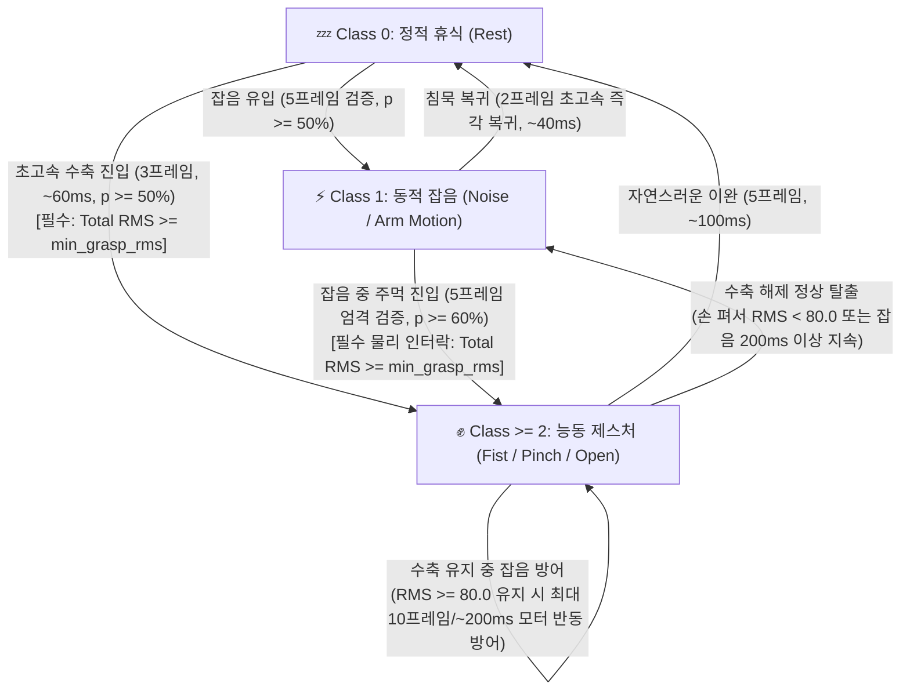

# **시계열 윈도우 및 블록 신경망(Modular Block NN) 모델링 원리와 구현 명세서**

# **1\. 신경망 모델링의 수학적·신호처리적 기초 원리**

단순 1차원 다층 퍼셉트론(Vanilla 1D MLP)을 2차원 시계열 윈도우 기반의 모듈형 블록 신경망(Dual-Stream Stem \- Temporal/Channel Mixing Backbone \- Tri-Phasic Output Head \- Physical Energy Gate)으로 고도화하는 과정은 다음 네 가지 수학적·생리학적 기초 원리에 근거합니다.

## **1.1 타켄스의 지연 임베딩 정리(Takens' Delay Embedding)와 위상 공간 복원**

* **단일 스냅샷의 한계:** 1차원 정적 벡터 $\mathbf{x}_t \in \mathbb{R}^{d_{\text{in}}}$ 만을 입력받는 모델은 시스템이 현재 '어디에 있는가(0차 상태)'만 관측할 뿐, '어느 방향으로 얼마나 빠르게 움직이는가(1차 미분 속도 $d\mathbf{x}/dt \approx \mathbf{x}_t - \mathbf{x}_{t-1}$, 2차 미분 가속도 $d^2\mathbf{x}/dt^2 \approx \mathbf{x}_t - 2\mathbf{x}_{t-1} + \mathbf{x}_{t-2}$)'를 알 수 없습니다. 즉, 동일한 위치 값이라도 상승 중인지 하강 중인지 구별할 수 없어 상태 추정의 모호성(State Aliasing)이 발생합니다.  
* **지연 임베딩을 통한 궤적 복원:** 동역학계 이론(타켄스 정리)에 따르면, 단일 시점의 관측치라도 과거 $T$개의 지연 샘플 $[\mathbf{x}_{t-T+1}, \dots, \mathbf{x}_t]$를 묶어 $\mathbb{R}^{T \times d_{\text{in}}}$의 2차원 윈도우 행렬로 구성하면 원래 시스템의 숨겨진 위상 공간(Phase Space) 궤적과 미분 특성을 완벽히 복원할 수 있습니다.

## **1.2 심층 신경망의 역전파 동역학과 잔차 항등 경로(Identity Highway)**

* **연쇄 법칙과 야코비안 곱의 붕괴:** 일자형 MLP에서 $L$개의 층을 거칠 때 입력 $\mathbf{x}_0$에 대한 손실 $\mathcal{L}$의 기울기는 연쇄 법칙(Chain Rule)에 의해 각 층의 야코비안(Jacobian) 행렬의 곱 $\frac{\partial \mathcal{L}}{\partial \mathbf{x}_0} = \frac{\partial \mathcal{L}}{\partial \mathbf{x}_L} \cdot \prod_{l=1}^L \frac{\partial \mathbf{x}_l}{\partial \mathbf{x}_{l-1}}$ 로 계산됩니다. 가중치 행렬의 특이값(Singular Value)이 1보다 작으면 층이 깊어질수록 기울기가 지수적으로 0에 수렴(기울기 소실)하여 앞단 레이어가 전혀 학습되지 않습니다.  
* **덧셈 분기를 통한 기울기 보존:** 블록의 입출력을 $\mathbf{x}_l = \mathbf{x}_{l-1} + \mathcal{F}(\mathbf{x}_{l-1})$ 형태의 잔차 연결(Residual Connection)로 정의하면, 미분식이 $\frac{\partial \mathbf{x}_l}{\partial \mathbf{x}_{l-1}} = \mathbf{I} + \frac{\partial \mathcal{F}(\mathbf{x}_{l-1})}{\partial \mathbf{x}_{l-1}}$ 로 변환됩니다. 여기서 단위 행렬 $\mathbf{I}$(상수 1)가 덧셈 항으로 존재하므로, 비선형 블록의 미분값이 0에 가까워지더라도 상위 층의 오차 신호가 단위 행렬 $\mathbf{I}$를 타고 최하단 입력층까지 감쇠 없이 직접 전달됩니다.

## **1.3 손실 지형(Loss Landscape)의 곡률 안정화와 등방성 정규화**

* **내부 공변량 변화와 비등방성(Anisotropy):** 선형 계층 $\mathbf{y} = \mathbf{W}\mathbf{x} + \mathbf{b}$에서 가중치 기울기는 $\frac{\partial \mathcal{L}}{\partial \mathbf{W}} = \frac{\partial \mathcal{L}}{\partial \mathbf{y}} \cdot \mathbf{x}^\top$ 입니다. 입력 $\mathbf{x}$의 특정 채널 스케일이 크거나 층을 거치며 평균·분산이 흔들리면, 손실 함수의 헤시안(Hessian) 행렬 고유값 비율(조건수, Condition Number)이 극도로 커져 손실 지형이 좁고 가파른 협곡 형태가 됩니다. 이 상태에서는 경사하강법이 최적점으로 직진하지 못하고 벽면을 따라 지그재그로 진동합니다.  
* **정규화를 통한 초구(Hypersphere) 투영:** 각 블록 진입 전에 정규화(LayerNorm 또는 RMSNorm)를 수행하면 입력 벡터의 분포가 평균 0, 분산 1의 등방성(Isotropic) 공간으로 강제 정렬되어 헤시안 조건수가 낮아지고, 높은 학습률에서도 부드럽고 빠른 수렴이 보장됩니다.

## **1.4 골격근 등척성 수축의 3상 생체역학(Tri-Phasic Biomechanics)과 근시너지 불변성**

* **등척성 유지 시 3단계 상전이(Phase Transition):** 사용자가 일정한 악력으로 주먹을 쥐고 유지하더라도, 표면 근전도(sEMG) 신호는 다음 3단계를 거칩니다:
  1. **Phase 1 (Phasic Onset Burst, 0~2초):** 고역치 속근(Type II) 섬유의 폭발적 동원 $\to \text{Total RMS} \in [340, 515]$.
  2. **Phase 2 (Tonic Isometric Plateau, 2~5초):** 지근(Type I) 비동기 발화로 전환 $\to \text{Total RMS} \in [134, 250]$ (**40~60% 진폭 감쇠**).
  3. **Phase 3 (Motor Unit Rotation Tremor, 5~9초):** 근피로 지연을 위한 운동단위 교대 발화 및 8~12Hz 생리적 진전(Tremor) 리플.
* **불변량으로서의 공간 근시너지(Spatial Muscle Synergy):** 진폭 에너지가 절반으로 감소하더라도, 5개 전완근 채널 간의 L2 정규화 상대 활성 비율 $\hat{\mathbf{r}} = \mathbf{r}/\|\mathbf{r}\|_2$은 **전 구간에서 $[0.491, 0.473, 0.371, 0.611, 0.154]$로 일정 불변(Invariant)**합니다. 따라서 신경망은 스케일에 종속되지 않는 공간 근시너지 패턴과 단조 수축 에너지를 직교 분리하여 처리해야 합니다.

# **2\. 구현 순서별 7단계 상세 모델링 및 엔지니어링 명세**

## **단계 1: 시계열 슬라이딩 윈도우 버퍼링 및 텐서 구조화 (Temporal Windowing & Ring Buffer)**

1차원 연속 스트림 데이터를 신경망이 시간적 맥락을 해석할 수 있는 3차원 텐서 X ∈ ℝ^(B × T × d\_in) (배치 B, 윈도우 길이 T, 피처 수 d\_in)로 변환하는 데이터 파이프라인 단계입니다.

* **기능 1.1 — 세션 단위 시계열 분할 (자기상관 데이터 누수 차단):**  
  * **기초 근거:** 시계열 데이터는 인접 시점 간 강한 자기상관(Autocorrelation, Cov(x\_t, x\_{t+1}) \>\> 0)을 가집니다. 전체 시계열에서 슬라이딩 윈도우(스트라이드 1)를 먼저 추출한 뒤 무작위(Random Split)로 학습·검증 세트를 나누면, 학습 샘플 X\_t와 검증 샘플 X\_{t+1}이 T-1개의 프레임을 완전히 공유하게 됩니다. 이 경우 모델은 일반화 규칙을 학습하는 대신 경계 프레임을 단순 암기(Memorization)하여 검증 성능이 허수로 부풀려집니다.  
  * **구현 원칙:** 반드시 원본 1차원 데이터를 수집 세션(Session)이나 시간 블록 단위로 먼저 Train / Validation / Test로 격리 분할한 뒤, 분할된 각 구간 내부에서만 독립적으로 슬라이딩 윈도우를 생성해야 합니다.  
* **기능 1.2 — 고정 크기 링 버퍼(FIFO Circular Queue) 구현:**  
  * **기초 근거:** 실시간 추론 시 매 프레임마다 배열의 첫 요소를 삭제하고 끝에 새 요소를 추가(Shift 연산)하면 매번 O(T × d\_in)의 메모리 복사(memcpy) 오버헤드와 캐시 미스가 발생합니다.  
  * **구현 원칙:** 길이 T의 고정 메모리 버퍼와 쓰기 인덱스(write\_ptr)를 두고, 새 프레임 유입 시 buffer\[write\_ptr\]를 덮어쓴 뒤 write\_ptr \= (write\_ptr \+ 1\) % T 로 순환시켜 메모리 할당 비용을 O(1)로 고정합니다.  
* **기능 1.3 — 초기 경계 효과 제거를 위한 복제 패딩(Replicate Padding):**  
  * **기초 근거:** 시스템 가동 직후 버퍼가 채워지기 전(t \< T) 구간을 0(Zero Padding)으로 채우면, 0에서 실제 센서/피처 값으로 넘어가는 경계 지점에서 계단 함수(Step Function) 형태의 인위적인 급격한 변화율(고주파 스파이크 노이즈)이 발생하여 초기 추론값이 심하게 튑니다.  
  * **구현 원칙:** 첫 번째 유효 프레임 x\_0가 입력되는 순간 버퍼의 T개 슬롯 전체를 x\_0로 일괄 복제 초기화하여, 초기 상태의 시간 미분값(dx/dt)을 0으로 안정화합니다.  
* **기능 1.4 — 채널별 분포 정규화(Channel-wise Affine Standardization):**  
  * **기초 근거:** 피처마다 물리적 단위와 변동 폭이 다르면 스케일이 큰 피처가 내적 연산(w^T x)을 지배합니다.  
  * **구현 원칙:** 학습 세트에서 산출한 채널별 평균 μ ∈ ℝ^(d\_in)와 표준편차 σ ∈ ℝ^(d\_in)(또는 왜도가 심할 경우 Yeo-Johnson / Quantile 변환기)를 고정 파라미터로 저장하고, 윈도우 내 모든 프레임에 동일하게 (x \- μ) / (σ \+ ε) 변환을 적용합니다.

## **단계 2: 입력 투영부 구현 (Dual-Stream Physiology-Aware Input Stem)**

원시 피처 공간($d_{\text{in}}$)의 데이터를 백본 블록의 표준 은닉 공간($d_{\text{model}}$)으로 매핑하고, **근육의 공간적 협응 패턴(Spatial Synergy)**과 **단조 수축 강도(Monotonic Contraction Intensity)**를 직교 분리하여 결합하는 생리학적 어댑터 계층입니다.

* **기능 2.1 — 점별 선형 투영(Point-wise Linear Projection):**  
  * **기초 근거:** 커버의 정리(Cover's Theorem)에 따라 저차원에서 비선형적으로 얽힌 패턴은 고차원 공간으로 투영할 때 선형 분리 가능성이 높아집니다. 또한 잔차 연결($\mathbf{x} + \text{Block}(\mathbf{x})$)이 성립하려면 첫 번째 블록에 진입하기 전에 텐서의 차원이 $d_{\text{model}}$로 통일되어야 합니다.  
  * **구현 원칙:** 입력 텐서 $\mathbf{Z} \in \mathbb{R}^{B \times T \times d_{\text{in}}}$의 마지막 축에 가중치 행렬 $\mathbf{W}_{\text{stem}} \in \mathbb{R}^{d_{\text{in}} \times d_{\text{model}}}$을 곱해 모든 시점 $t = 1 \dots T$를 동일한 변환 규칙으로 $\mathbb{R}^{B \times T \times d_{\text{model}}}$ 잠재 공간에 투영합니다.  
* **기능 2.2 — 2-스트림 생리학적 분리: 스케일 불변 공간 패턴($\mathbf{H}_{\text{pat}}$) & 단조 수축 강도 게이트($\mathbf{G}_{\text{int}}$):**  
  * **수학적·생리학적 근거 (Z-Score L2 노름의 영점 함몰 특이점 증명):**  
    입력 특징 $\mathbf{z}_t = (\mathbf{x}_t - \boldsymbol{\mu}) \oslash \boldsymbol{\sigma}$는 전체 학습 데이터셋의 평균 $\boldsymbol{\mu}$를 뺀 Z-Score 표준화 벡터입니다. 만약 `LayerNorm`으로 소실된 진폭 에너지를 복원하기 위해 대칭 2차 노름 $E_{\text{quad}}(\mathbf{z}_t) = \sqrt{\frac{1}{d_{\text{in}}}\sum_{k=1}^{d_{\text{in}}} z_{t,k}^2}$를 곱하면, 그 도함수는 다음과 같습니다:
    $$\frac{\partial E_{\text{quad}}(\mathbf{z}_t)}{\partial x_{t,k}} = \frac{x_{t,k} - \mu_k}{d_{\text{in}}\,\sigma_k^2\,E_{\text{quad}}(\mathbf{z}_t)}$$
    즉, 물리적 근수축 에너지가 데이터셋 전체 평균($\mathbf{x}_t = \boldsymbol{\mu}$, 12세트 지속 주먹 데이터셋에서 $\sum \mu_{\text{RMS}} = 157.85$)과 일치하는 순간 $\mathbf{z}_t = \mathbf{0}$이 되어 **$E_{\text{quad}}(\mathbf{0}) = 0$ (전역 최소값 사각지대)**으로 함몰됩니다! 골격근이 주먹을 꽉 쥐고 유지할 때 초기 속근(Type II) 폭발기(`RMS 350~500`, $z > 0$)에서 지근(Type I) 등척성 유지기(`RMS 140~190`, $z \approx 0$)로 내려오면, 휴식기(`RMS 46`, $z \approx -1.0$, $E_{\text{quad}} = 0.859$)보다 오히려 지속 주먹 유지기($z \approx 0$, $E_{\text{quad}} = 0.371 \sim 0.650$)의 에너지 스케일이 더 작아져 주먹이 강제로 풀리는 치명적 모순이 발생합니다.  
  * **엄격한 단조 수축 게이트(Strict Monotonic Intensity Gate) 증명:**  
    이를 해결하기 위해 2차 노름을 제거하고 아핀-시그모이드 게이트 $\mathbf{G}_{\text{int}}(\mathbf{z}_t) = 2\,\sigma(\mathbf{W}_{\text{int}}\mathbf{z}_t + \mathbf{b}_{\text{int}}) \in (0, 2)^{d_{\text{model}}}$를 도입합니다. 수축 방향 가중치 투영값 $\xi = \mathbf{w}_{\text{int}}^\top \mathbf{z}_t + b_{\text{int}}$에 대한 미분은 모든 실수 구간 $\xi \in (-\infty, +\infty)$에서 항상 양수입니다:
    $$\frac{\partial G_{\text{int}}(\xi)}{\partial \xi} = 2\,\sigma(\xi)\bigl(1 - \sigma(\xi)\bigr) > 0 \quad (\forall \xi \in \mathbb{R}), \qquad G_{\text{int}}(0) = 1.0$$
    따라서 **정적 휴식($z < 0, G_{\text{int}} < 1$) $<$ 등척성 지속 수축($z \approx 0, G_{\text{int}} \approx 1.0$) $<$ 초기 폭발 수축($z > 0, G_{\text{int}} \to 2.0$)**의 엄격한 단조 증가 순서(Order-Preserving Monotonicity)가 수학적으로 보장됩니다. 동시에 `LayerNorm` 경로인 $\mathbf{H}_{\text{pat}} = \text{GELU}(\text{LN}(\mathbf{W}_{\text{stem}}\mathbf{z}_t + \mathbf{b}_{\text{stem}}))$는 동차성 $\text{LN}(c\,\mathbf{h}) = \text{LN}(\mathbf{h})$ ($c > 0$)에 의해 등척성 진폭 감쇠에 완전 불변하는 **5채널 근육 공간 협응 비율(Spatial Muscle Synergy)**만을 순수하게 추출합니다.  
* **기능 2.3 — 학습 가능한 시점 위치 인코딩(Learnable Positional Encoding):**  
  * **기초 근거:** 피처 축 연산 자체는 시점 순서에 불변(Permutation Invariant)하므로, 각 프레임이 '현재 시점($t=T-1$)'인지 '과거 시점($t=0$)'인지에 대한 명시적 시간 좌표가 필요합니다.  
  * **구현 원칙:** 학습 가능한 파라미터 텐서 $\mathbf{P} \in \mathbb{R}^{1 \times T \times d_{\text{model}}}$을 작은 정규분포($\text{std}=0.02$)로 초기화하여 Dual-Stream Stem 출력 텐서에 원소별 덧셈으로 결합합니다:
    $$\mathbf{H}^{(0)} = \mathbf{H}_{\text{pat}} \odot \mathbf{G}_{\text{int}} + \mathbf{P}$$

## **단계 3: 시간 축 혼합 블록 구현 (Temporal Mixing Block: Cross-Step Dynamics)**

무거운 O(T²) 어텐션 연산 없이 순수 행렬곱만으로 T개의 프레임 간 시간적 상관관계와 다중 스케일 미분 특성(속도, 가속도, 추세)을 추출하는 모듈입니다.

* **기능 3.1 — Pre-Norm 및 텐서 차원 전치(Transpose):**  
  * **기초 근거:** 표준 선형 계층(Linear)은 항상 텐서의 가장 마지막 차원에 대해 내적을 수행합니다. 따라서 시간 축(T) 방향으로 데이터를 섞으려면 시간 차원과 채널 차원의 메모리 축을 맞바꾸어야 합니다.  
  * **구현 원칙:** 입력 X ∈ ℝ^(B × T × d\_model)에 먼저 LayerNorm(d\_model)을 적용한 뒤, transpose(1, 2)를 호출하여 텐서 형상을 ℝ^(B × d\_model × T)로 변환합니다.  
* **기능 3.2 — 채널 공유 시간 병목 투영(Channel-Shared Temporal MLP):**  
  * **기초 근거:** d\_model개의 모든 잠재 채널에 대해 동일한 시간 변환 행렬 W\_time1 ∈ ℝ^(T × d\_T)와 W\_time2 ∈ ℝ^(d\_T × T)를 적용하면, 이 가중치 행렬의 각 행(Row)은 신호처리에서의 학습 가능한 유한 임펄스 응답(FIR) 필터(예: 저역통과 평활화 필터, 1차 차분 미분 필터, 2차 차분 곡률 필터 등)로 동작합니다. 채널 간 가중치를 공유하므로 파라미터 수가 T² 수준으로 매우 작아 과적합이 방지됩니다.  
  * **구현 원칙:** 전치된 텐서에 Linear(T, d\_T) → GELU() → Dropout() → Linear(d\_T, T) → Dropout()을 적용합니다. 이때 시간 은닉 차원 d\_T는 보통 T와 같거나 2T로 설정합니다.  
* **기능 3.3 — 차원 복원 및 시간 잔차 합산:**  
  * **기초 근거:** 기존 프레임의 고유 특징(X)을 잃지 않으면서 시간적 문맥 변화량(ΔX\_time)만 보강해야 합니다.  
  * **구현 원칙:** 연산 결과를 다시 transpose(1, 2)로 ℝ^(B × T × d\_model)로 되돌린 후, 원본 입력과 합산(Y \= X \+ ΔX\_time)합니다.

## **단계 4: 피처 축 비선형 고도화 블록 구현 (Channel Mixing Block: Intra-Step Feature Gating)**

시간 문맥이 반영된 각 타임스텝 내부에서 d\_model개의 채널 간 고차 비선형 상호작용(Feature Interaction)을 추출하는 핵심 표현력 담당 모듈입니다.

* **기능 4.1 — 역병목(Inverted Bottleneck) 구조의 기하학적 분리:**  
  * **기초 근거:** d\_model 차원의 잔차 스트림을 유지하면서 블록 내부에서만 은닉 차원을 k배(보통 k=2\~4) 확장(d\_hidden \= k × d\_model)하면, 저차원에서 겹쳐 있던 결정 경계를 고차원 초평면에서 넓게 펼쳐 비선형 활성화 함수로 정교하게 마스킹한 뒤 다시 d\_model로 선형 압축할 수 있습니다.  
  * **구현 원칙:** LayerNorm(d\_model) → Linear(d\_model, k \* d\_model) → GELU() → Dropout() → Linear(k \* d\_model, d\_model) → Dropout() 후 잔차 합산을 수행합니다.  
* **기능 4.2 — SwiGLU 곱셈 게이팅(Multiplicative Gating)을 통한 2차 교차항 모델링:**  
  * **기초 근거:** 일반 선형 계층 \+ 활성화 함수 σ(W x)는 입력 변수들의 1차 선형 결합(∑ w\_i x\_i)에만 비선형성을 부여합니다. 반면 입력을 두 갈래로 나누어 원소별 곱셈(Hadamard Product, ⊙)을 수행하는 SwiGLU 구조인 SiLU(W\_gate x) ⊙ (W\_val x)는 수식 전개 시 (∑ w\_{g,i} x\_i) × (∑ w\_{v,j} x\_j) 형태가 되어, 단일 블록 내부에서 입력 피처 간의 2차 다항 교차항(Quadratic Cross-Terms, x\_i · x\_j)을 직접 생성합니다. 또한 역전파 시 미분식이 곱의 미분법 ∂(u ⊙ v)/∂x \= (∂u/∂x) ⊙ v \+ u ⊙ (∂v/∂x)를 따르므로, 불필요한 노이즈 채널은 Gate 값을 0으로 닫아 차단하고 유의미한 상호작용 신호만 증폭하는 동적 라우팅 효과를 냅니다.  
  * **구현 원칙:** 정규화된 입력을 w\_gate와 w\_val 두 개의 선형 계층에 동시에 통과시킨 뒤 F.silu(w\_gate(x)) \* w\_val(x)를 계산하고, Dropout 후 w\_out 계층으로 d\_model 차원까지 압축합니다.  
* **기능 4.3 — 파라미터 및 FLOPs 등가 차원 설계 (2/3 × 4 × d\_model):**  
  * **기초 근거:** 표준 Inverted Bottleneck(확장비 4)은 (d × 4d) 행렬 2개를 사용하여 총 8d²개의 파라미터를 가집니다. 반면 SwiGLU는 선형 행렬을 3개(w\_gate, w\_val, w\_out) 사용하므로 은닉 차원을 그대로 4d로 두면 파라미터가 12d²로 1.5배 증가합니다.  
  * **구현 원칙:** 총 파라미터 수와 연산량을 8d²로 정확히 일치시키기 위해 SwiGLU의 은닉 차원을 d\_hidden \= int((2 / 3\) \* (4 \* d\_model)) (약 2.67 × d\_model, 하드웨어 정렬을 위해 8 또는 16의 배수로 반올림)로 설정하고, 게이팅 구조에서 불필요한 선형 편향(bias=False)을 제거합니다.

## **단계 5: 반복 백본 적층 및 잔차 경로 안정화 (Repeatable Backbone & Deep Signal Propagation)**

단계 3(Temporal Mixing)과 단계 4(Channel Mixing)를 결합한 단위 슈퍼 블록을 N개 적층하고, 깊은 층에서의 신호 분산 폭주를 제어하는 단계입니다.

* **기능 5.1 — 잔차 분산 누적 억제와 영점/소규모 가중치 초기화(Zero/Small-Init):**  
  * **기초 근거:** Pre-Norm 잔차 네트워크 x\_L \= x\_0 \+ ∑\_{l=1..L} F\_l(x\_{l-1}) 에서 각 블록 출력 F\_l의 분산이 σ²이고 서로 독립에 가깝다면, L번째 블록을 통과한 신호의 분산은 Var(x\_L) ≈ Var(x\_0) \+ L · σ² 로 층 수 L에 비례해 선형 증가합니다. 이로 인해 깊은 층에서는 학습 초기부터 신호 스케일이 비대해져 기울기가 불안정해집니다.  
  * **구현 원칙:** 각 잔차 블록의 가장 마지막 선형 계층(fc2 또는 w\_out)의 가중치를 표준편차 0.02 / √(2 × N\_blocks) 의 작은 정규분포(또는 완전한 0)로 초기화합니다. 이렇게 하면 학습 시작 시점에 모든 블록의 출력 F\_l(x) ≈ 0 이 되어 전체 깊은 네트워크가 완벽한 항등 함수(x\_L ≈ x\_0) 상태에서 출발하며, 학습이 진행됨에 따라 필요한 블록부터 점진적으로 비선형성을 획득합니다.  
* **기능 5.2 — LayerScale 및 Stochastic Depth (DropPath):**  
  * **기초 근거:** 블록이 많아질수록 모든 채널이 동일한 속도로 잔차 스트림에 더해지면 특정 지배적 채널에 과적합되기 쉽습니다.  
  * **구현 원칙:**  
    * **LayerScale:** 잔차 합산 직전 블록 출력에 학습 가능한 채널별 미소 스케일 벡터 γ\_scale ∈ ℝ^(d\_model)(초기값 1e-4)을 원소별로 곱해(x \+ γ\_scale ⊙ F(x)) 채널별 학습 속도를 자율 조절합니다.  
    * **DropPath:** 학습 시 미니배치 내 개별 샘플 단위로 확률 p\_l (첫 블록 0에서 마지막 블록 p\_max까지 선형 증가)만큼 블록 연산 F\_l(x) 전체를 통째로 0으로 마스킹하여, 서로 다른 깊이를 가진 2^N개의 부분 네트워크 앙상블 효과를 유도합니다.  
* **기능 5.3 — 피라미드 차원 전환 시 선형 투영 숏컷(Projection Shortcut):**  
  * **기초 근거:** 만약 연산량 절감이나 정보 병목 유도를 위해 스테이지마다 은닉 차원을 줄이는 피라미드 구조(예: 256 → 128)를 채택할 경우, x ∈ ℝ^(d\_in)와 F(x) ∈ ℝ^(d\_out)의 차원이 달라 덧셈이 불가능합니다.  
  * **구현 원칙:** 차원이 변하는 전환 블록의 스킵 커넥션 경로에 편향이 없는 선형 투영 행렬 W\_proj ∈ ℝ^(d\_in × d\_out)를 배치하여 Y \= W\_proj(X) \+ F(X) 로 부분공간(Subspace) 차원을 정렬합니다.

## **단계 6: 3상 생체역학 시점 집약 및 출력 예측부 구현 (Output Head: Tri-Phasic Biomechanical Readout)**

백본을 통과한 3차원 특징 텐서 $\mathbb{R}^{B \times T \times d_{\text{model}}}$의 최종 스케일을 보정하고, 골격근 수축의 3상 동역학(초기 위상성 동원 $\to$ 등척성 지속 유지 $\to$ 운동단위 교대 발화)을 동시에 포착하여 목표 예측값 $\mathbb{R}^{B \times d_{\text{out}}}$을 산출하는 단계입니다.

* **기능 6.1 — 종단 정규화(Final LayerNorm) 및 단조 강도 복원:**  
  * **기초 근거:** Pre-Norm 아키텍처에서는 각 블록의 입력만 정규화될 뿐, 블록의 출력은 정규화 없이 잔차 스트림에 계속 합산($\mathbf{x}_L = \mathbf{x}_0 + \sum \mathbf{F}_l$)됩니다. 따라서 마지막 블록을 빠져나온 텐서 $\mathbf{x}_L$은 누적된 분산으로 인해 스케일이 크게 부풀어 있으며, 이를 곧바로 출력 선형 계층에 통과시키면 초기 로짓(Logit) 값이 과도하게 커져 손실 함수(특히 Softmax 교차 엔트로피)의 기울기가 포화(Saturation)됩니다.  
  * **구현 원칙:** 마지막 백본 블록 직후 독립된 `LayerNorm(d_model)`을 배치하여 누적된 잔차 스트림을 다시 평균 0, 분산 1로 정규화한 뒤, 단계 2에서 산출한 단조 수축 강도 게이트 $\mathbf{G}_{\text{int}}$를 재결합합니다:
    $$\widetilde{\mathbf{H}} = \text{LN}_{\text{final}}\bigl(\mathbf{H}^{(N)}\bigr) \odot \mathbf{G}_{\text{int}} \in \mathbb{R}^{B \times T \times d_{\text{model}}}$$
* **기능 6.2 — 3상 생체역학 다중 스케일 응축(Tri-Phasic Biomechanical Aggregation):**  
  * **기초 근거 (단일 프레임 슬라이싱의 생리학적 한계):**  
    가장 최신 프레임 $\widetilde{\mathbf{H}}_{:, T-1, :}$만 단독 추출(Single-frame Causal Slicing)하면 위상 지연은 없으나, 주먹을 2초 이상 지속 유지하는 **Phase 2(등척성 지근 유지기)** 및 **Phase 3(8~12Hz 운동단위 순환 교대기)**에서 발화 스파이크 사이의 20ms 골짜기(Inter-spike trough)가 최신 슬롯 $t = T-1$에 걸리는 순간 특징 벡터가 요동치는 취약점이 있습니다.  
  * **구현 원칙 (Phasic + Tonic + Flux 3상 융합):**  
    이를 완벽히 해결하기 위해 윈도우 $T=8$ (`160ms`, 8~12Hz 알파 운동신경 발화 주기의 약 1.5~2사이클 포괄) 내부에서 서로 직교하는 3가지 생체역학적 물리량을 동시에 추출하여 결합합니다:
    1. **위상성 즉각 반응 상태 (Phasic Instantaneous State, $\mathbf{f}_{\text{last}}$):** 최신 프레임 $\widetilde{\mathbf{H}}_{:, T-1, :}$을 직접 반영하여 수축 개시(Onset) 시 위상 지연(Phase Lag)이 전혀 없는 즉각적 반응성을 보장합니다.
    2. **긴장성 등척 유지 상태 (Tonic Isometric Sustain State, $\mathbf{f}_{\text{tonic}}$):** 윈도우 전체 시간 평균 $\frac{1}{T}\sum_{t=0}^{T-1}\widetilde{\mathbf{H}}_{:, t, :}$을 계산하여, 운동단위 비동기 발화로 인한 순간적 진폭 골짜기 분산을 $\text{Var}(\mathbf{f}_{\text{tonic}}) = \frac{1}{T}\sigma_{\text{spike}}^2$ (87.5% 감소)로 적분 평활화합니다.
    3. **수축 동역학 플럭스 미분 (Contraction Flux Derivative, $\mathbf{f}_{\text{flux}}$):** 윈도우 양 끝단의 유한 차분 $\widetilde{\mathbf{H}}_{:, T-1, :} - \widetilde{\mathbf{H}}_{:, 0, :} \approx \int_{t_0}^{t_{T-1}} \frac{\partial \widetilde{\mathbf{H}}(\tau)}{\partial \tau}\,d\tau$를 산출하여, **수축 개시($\mathbf{f}_{\text{flux}} > \mathbf{0}$)**, **등척성 지속 유지($\mathbf{f}_{\text{flux}} \approx \mathbf{0}, \mathbf{f}_{\text{tonic}} > \mathbf{0}$)**, **의도적 이완 해제($\mathbf{f}_{\text{flux}} < \mathbf{0}$)**의 3가지 위상 궤적을 수학적으로 명확히 분리합니다.
    $$\mathbf{f}_{\text{tri}} = \underbrace{\widetilde{\mathbf{H}}_{:, T-1, :}}_{\text{Phasic Onset}} + \mathbf{W}_{\text{tonic}}\underbrace{\left(\frac{1}{T}\sum_{t=0}^{T-1}\widetilde{\mathbf{H}}_{:, t, :}\right)}_{\text{Tonic Sustain}} + \mathbf{W}_{\text{flux}}\underbrace{\left(\widetilde{\mathbf{H}}_{:, T-1, :} - \widetilde{\mathbf{H}}_{:, 0, :}\right)}_{\text{Contraction Flux}}$$
* **기능 6.3 — 순수 선형 타겟 투영(Unactivated Readout Linear):**  
  * **기초 근거:** 출력층 끝에 Sigmoid나 Softmax를 직접 붙이면 극단값에서 부동소수점 언더플로우/오버플로우가 발생합니다.  
  * **구현 원칙:** Output Head의 마지막은 활성화 함수가 없는 순수 `Linear(d_model, d_out)`로 끝내어 원시 로짓($\mathbf{y} = \mathbf{W}_{\text{head}}\mathbf{f}_{\text{tri}} + \mathbf{b}_{\text{head}}$)을 출력하고, 확률 변환은 수치적으로 안정화된 손실 함수(Label Smoothing $\varepsilon=0.05$가 결합된 CrossEntropyLoss)에 위임합니다.

## **단계 7: 정규화 스케줄링 및 실시간 추론 루프 결합 (Optimization Geometry & Real-Time Deployment)**

설계된 아키텍처가 넓고 평탄한 최적점(Flat Minima)에 수렴하도록 파라미터 그룹별 최적화를 구성하고, 학습-추론 간 불일치 없이 배포하는 단계입니다.

* **기능 7.1 — 배치 독립적 정규화(LayerNorm / RMSNorm)를 통한 추론 결정론 보장:**  
  * **기초 근거:** BatchNorm1d는 학습 시 미니배치(B \> 1\) 샘플들 간의 평균·분산을 사용하고 추론 시에는 학습 중 누적한 이동평균(Running Mean/Var)을 사용합니다. 그러나 시계열 스트림이나 온디바이스 실시간 추론(B \= 1)에서는 미니배치 통계량과 단일 샘플의 분포가 어긋나는 치명적인 학습-추론 불일치(Train-Test Discrepancy)가 발생합니다.  
  * **구현 원칙:** 전 구간에서 배치 축(B)과 무관하게 단일 샘플의 채널 축(d\_model) 내부에서만 정규화를 수행하는 LayerNorm 또는 평균 차감을 생략해 연산 속도를 높인 RMSNorm(x / √(mean(x²) \+ ε) \* γ)을 사용하여, B=1 실시간 추론에서도 학습 시점과 수학적으로 100% 동일한 출력을 보장합니다.  
* **기능 7.2 — 분리된 가중치 감쇠(AdamW)와 파라미터 그룹 이원화(Weight Decay Exclusion):**  
  * **기초 근거:** Adam 옵티마이저에 일반 L2 정규화를 쓰면 기울기 제곱의 이동평균(v\_t)으로 나뉘어 기울기가 큰 가중치일수록 정규화 효과가 사라집니다. 따라서 가중치 감쇠 항을 분리한 AdamW를 써야 합니다. 이때 모든 파라미터에 일괄적으로 Weight Decay를 적용하면, LayerNorm의 스케일 파라미터(γ, 기본값 1)와 편향(bias), 위치 인코딩(P)까지 0으로 수축시켜 신경망의 표현력을 심각하게 훼손합니다.  
  * **구현 원칙:** 옵티마이저에 파라미터를 넘길 때 반드시 2차원 이상의 행렬 가중치(Linear.weight)만 decay\_group(예: weight\_decay=1e-2)에 넣고, 1차원 이하의 모든 텐서(bias, LayerNorm.weight, LayerNorm.bias, LayerScale, Positional Encoding)는 no\_decay\_group(weight\_decay=0.0)으로 엄격히 분리합니다.  
* **기능 7.3 — 선형 웜업 결합 코사인 어닐링(Cosine Annealing with Linear Warmup):**  
  * **기초 근거:** 학습 시작 직후(Step 1\~100)에는 AdamW의 2차 모멘텀(v\_t) 표본이 부족해 분산 추정치가 0에 가까워지며, 이로 인해 유효 스텝 크기가 비정상적으로 증폭되어 초기 가중치가 튀는 현상이 발생합니다.  
  * **구현 원칙:** 전체 학습 스텝의 첫 5\~10% 구간에서는 학습률을 0에서 목표치(예: 1e-3)까지 선형적으로 증가(Linear Warmup)시켜 모멘텀 통계량이 안정화될 시간을 확보하고, 이후 코사인 곡선을 따라 최소 학습률(예: 1e-6)까지 부드럽게 감쇠시켜 좁은 지역 최적점을 탈출하고 평탄한 최적점에 안착시킵니다.
* **기능 7.4 — 생체역학적 수축 에너지 물리 인터락(Physical Contraction Energy Gate) 및 적응형 잡음 방어:**  
  * **기초 근거:** 동적 잡음(팔 흔들림, 옷깃 스침, 센서 미세 이동, $\text{RMS} \in [60, 100]$) 상황에서 고주파 노이즈 스파이크로 인해 신경망 Softmax가 단 2~3프레임 동안 일시적으로 Class $\ge 2$(주먹) 확률을 높게 출력할 수 있습니다. 이때 물리적 에너지 검속 없이 확률만으로 상태 전이를 확정하면 단 60ms 만에 주먹으로 오탐 전이되는 치명적 결함이 발생합니다.  
  * **구현 원칙:**  
    1. **수축 에너지 물리 인터락 (Energy Gate):** 능동 제스처(Class $\ge 2$) 진입 시 반드시 실측 물리 에너지 $\text{Total AC-RMS} \ge \max(\text{base\_rest\_rms} \times 1.8, \, 110.0)$ 조건을 동시 만족해야만 주먹 진입을 허용하며, 에너지 미달 시 `Class 1 (동적 잡음)`으로 강제 리매핑합니다.  
    2. **동적 잡음(1) $\to$ 주먹($\ge 2$) 전이 엄격화:** 잡음 상태 중 주먹 진입은 5프레임(~100ms) 연속 검증 및 $p \ge 60\%$ 확률을 요구하여 노이즈 스파이크 오탐을 원천 차단합니다.  
    3. **에너지 조건부 적응형 잡음 방어 (Adaptive Noise Hold & Release):** 주먹 유지 중 잡음(1) 발생 시, 등척성 유지 에너지($\text{RMS} \ge 80.0$)가 유지되는 동안에만 최대 10프레임(~200ms) 동안 서보 모터 반동 방어로 악력을 유지합니다. 손을 펴서 RMS가 80.0 미만으로 떨어졌거나 200ms 이상 잡음 지속 시 즉시 동적 잡음(1)으로 정상 탈출하여 서보 모터를 즉시 개방(`out_val = 0`)합니다.

# **3\. 단계별 텐서 형상(Shape) 및 핵심 수식 요약표**

| 단계 | 모듈 명칭 | 입력 텐서 형상 | 출력 텐서 형상 | 핵심 연산 및 수식 메커니즘 |
| :---- | :---- | :---- | :---- | :---- |
| 단계 1 | Sliding Ring Buffer | $\mathbb{R}^{d_{\text{in}}}$ (단일 프레임) | $\mathbb{R}^{B \times T \times d_{\text{in}}}$ | FIFO 순환 큐 + 초기 프레임 복제 패딩 + 채널별 Z-Score 표준화 |
| 단계 2 | Dual-Stream Physiology Stem | $\mathbb{R}^{B \times T \times d_{\text{in}}}$ | $\mathbb{R}^{B \times T \times d_{\text{model}}}$ | $\mathbf{H}_{\text{pat}} = \text{GELU}(\text{LN}(\mathbf{Z}\mathbf{W}_s + \mathbf{b}_s))$, $\mathbf{G}_{\text{int}} = 2\sigma(\mathbf{Z}\mathbf{W}_g + \mathbf{b}_g)$, $\mathbf{H}^{(0)} = \mathbf{H}_{\text{pat}} \odot \mathbf{G}_{\text{int}} + \mathbf{P}_{\text{pos}}$ |
| 단계 3 | Temporal Mixing | $\mathbb{R}^{B \times T \times d_{\text{model}}}$ | $\mathbb{R}^{B \times T \times d_{\text{model}}}$ | $\mathbf{H}' = \mathbf{H} + \gamma_t \odot \text{Transpose}(\text{MLP}_{\text{time}}(\text{Transpose}(\text{LN}(\mathbf{H}))))$ |
| 단계 4 | Channel Mixing | $\mathbb{R}^{B \times T \times d_{\text{model}}}$ | $\mathbb{R}^{B \times T \times d_{\text{model}}}$ | $\mathbf{H}'' = \mathbf{H}' + \gamma_c \odot ((\text{SiLU}(\text{LN}(\mathbf{H}')\mathbf{W}_g) \odot \text{LN}(\mathbf{H}')\mathbf{W}_v) \mathbf{W}_o)$ |
| 단계 5 | Repeatable Backbone | $\mathbb{R}^{B \times T \times d_{\text{model}}}$ | $\mathbb{R}^{B \times T \times d_{\text{model}}}$ | 단계 3 + 단계 4 결합 블록을 $N$회 반복 적층 (Small-Init & DropPath 적용) |
| 단계 6 | Tri-Phasic Output Head | $\mathbb{R}^{B \times T \times d_{\text{model}}}$ | $\mathbb{R}^{B \times d_{\text{out}}}$ | $\widetilde{\mathbf{H}} = \text{LN}(\mathbf{H}^{(N)}) \odot \mathbf{G}_{\text{int}}$, $\mathbf{f}_{\text{tri}} = \mathbf{f}_{\text{last}} + \mathbf{W}_{\text{tonic}}\mathbf{f}_{\text{tonic}} + \mathbf{W}_{\text{flux}}\mathbf{f}_{\text{flux}}$, $\mathbf{Y} = \mathbf{f}_{\text{tri}}\mathbf{W}_{\text{head}} + \mathbf{b}_{\text{head}}$ |
| 단계 7 | Stabilization & Physical Gate | $\mathbb{R}^{d_{\text{out}}}$, $\text{RMS}$ | 안정화 제스처 Index | $\text{RMS} \ge \text{Gate}$ 물리 인터락 + 적응형 200ms 잡음 방어 + 300ms 모터 불응기 |

# **4\. 전 과정 통합 레퍼런스 구현 코드**

## **4.1 PyTorch 기반 링 버퍼 \+ Temporal-SwiGLU 블록 신경망 \+ 옵티마이저 분리 통합 코드**

```py
import math
import numpy as np
import torch
import torch.nn as nn
import torch.nn.functional as F


# ==========================================
# [단계 1] 실시간 추론용 고정 크기 링 버퍼 (FIFO & 복제 패딩)
# ==========================================
class RealTimeRingBuffer:
    def __init__(self, window_size: int, num_features: int, mean: np.ndarray = None, std: np.ndarray = None):
        self.T = window_size
        self.C = num_features
        self.buffer = np.zeros((self.T, self.C), dtype=np.float32)
        self.write_ptr = 0
        self.is_initialized = False
        self.mean = mean if mean is not None else np.zeros(self.C, dtype=np.float32)
        self.std = std if std is not None else np.ones(self.C, dtype=np.float32)

    def push_and_get_window(self, frame: np.ndarray) -> torch.Tensor:
        """단일 1D 프레임(C,)을 입력받아 정규화된 2D 윈도우 텐서(1, T, C)를 반환"""
        norm_frame = (frame.astype(np.float32) - self.mean) / (self.std + 1e-8)

        # 초기 경계 스파이크 방지를 위한 첫 프레임 복제 패딩(Replicate Padding)
        if not self.is_initialized:
            self.buffer[:] = norm_frame
            self.write_ptr = 0
            self.is_initialized = True
        else:
            self.buffer[self.write_ptr] = norm_frame
            self.write_ptr = (self.write_ptr + 1) % self.T

        # 시간 순서(가장 오래된 프레임 -> 가장 최신 프레임)대로 정렬된 뷰 생성
        ordered = np.concatenate(
            [self.buffer[self.write_ptr:], self.buffer[:self.write_ptr]], axis=0
        )
        return torch.from_numpy(ordered).unsqueeze(0)  # Shape: (1, T, C)


# ==========================================
# [단계 5 보조] Stochastic Depth (DropPath)
# ==========================================
class DropPath(nn.Module):
    def __init__(self, drop_prob: float = 0.0):
        super().__init__()
        self.drop_prob = drop_prob

    def forward(self, x: torch.Tensor) -> torch.Tensor:
        if self.drop_prob == 0.0 or not self.training:
            return x
        keep_prob = 1.0 - self.drop_prob
        shape = (x.shape[0],) + (1,) * (x.ndim - 1)
        random_tensor = x.new_empty(shape).bernoulli_(keep_prob)
        return x.div(keep_prob) * random_tensor


# ==========================================
# [단계 3] 시간 축 혼합 블록 (Temporal Mixing Block)
# ==========================================
class TemporalMixingBlock(nn.Module):
    def __init__(self, window_size: int, d_model: int, expansion: int = 2, dropout: float = 0.1, num_blocks: int = 4):
        super().__init__()
        d_time_hidden = window_size * expansion
        self.norm = nn.LayerNorm(d_model)
        self.fc1 = nn.Linear(window_size, d_time_hidden)
        self.act = nn.GELU()
        self.drop1 = nn.Dropout(dropout)
        self.fc2 = nn.Linear(d_time_hidden, window_size)
        self.drop2 = nn.Dropout(dropout)

        # 잔차 분산 누적 억제를 위한 Small-Init
        nn.init.normal_(self.fc2.weight, std=0.02 / math.sqrt(2 * num_blocks))
        nn.init.zeros_(self.fc2.bias)

    def forward(self, x: torch.Tensor) -> torch.Tensor:
        # x: (B, T, d_model)
        h = self.norm(x)
        h = h.transpose(1, 2)          # (B, d_model, T)
        h = self.drop1(self.act(self.fc1(h)))
        h = self.drop2(self.fc2(h))
        h = h.transpose(1, 2)          # (B, T, d_model)
        return h


# ==========================================
# [단계 4] 피처 축 SwiGLU 게이팅 블록 (Channel Mixing Block)
# ==========================================
class SwiGLUChannelBlock(nn.Module):
    def __init__(self, d_model: int, dropout: float = 0.1, num_blocks: int = 4):
        super().__init__()
        # 파라미터 등가 차원 계산 (8/3 * d_model, 8의 배수로 정렬)
        raw_hidden = int((2 / 3) * (4 * d_model))
        d_hidden = ((raw_hidden + 7) // 8) * 8

        self.norm = nn.LayerNorm(d_model)
        self.w_gate = nn.Linear(d_model, d_hidden, bias=False)
        self.w_val = nn.Linear(d_model, d_hidden, bias=False)
        self.drop = nn.Dropout(dropout)
        self.w_out = nn.Linear(d_hidden, d_model, bias=False)

        # 잔차 분산 누적 억제를 위한 Small-Init
        nn.init.normal_(self.w_out.weight, std=0.02 / math.sqrt(2 * num_blocks))

    def forward(self, x: torch.Tensor) -> torch.Tensor:
        # x: (B, T, d_model)
        h = self.norm(x)
        gated = F.silu(self.w_gate(h)) * self.w_val(h)
        return self.w_out(self.drop(gated))


# ==========================================
# [단계 5] 시간+채널 결합 단위 슈퍼 블록 (LayerScale + DropPath 포함)
# ==========================================
class SpatioTemporalMlpBlock(nn.Module):
    def __init__(
        self,
        window_size: int,
        d_model: int,
        dropout: float = 0.1,
        drop_path: float = 0.0,
        layer_scale_init: float = 1e-4,
        num_blocks: int = 4,
    ):
        super().__init__()
        self.temporal_block = TemporalMixingBlock(window_size, d_model, expansion=2, dropout=dropout, num_blocks=num_blocks)
        self.channel_block = SwiGLUChannelBlock(d_model, dropout=dropout, num_blocks=num_blocks)

        self.gamma_time = nn.Parameter(layer_scale_init * torch.ones(d_model))
        self.gamma_chan = nn.Parameter(layer_scale_init * torch.ones(d_model))
        self.drop_path = DropPath(drop_path) if drop_path > 0.0 else nn.Identity()

    def forward(self, x: torch.Tensor) -> torch.Tensor:
        # 1. 시간 축 잔차 갱신
        x = x + self.drop_path(self.gamma_time * self.temporal_block(x))
        # 2. 채널(피처) 축 잔차 갱신
        x = x + self.drop_path(self.gamma_chan * self.channel_block(x))
        return x


# ==========================================
# [단계 2 ~ 단계 6] 전체 모듈형 시계열 블록 신경망 (Dual-Stream Stem + Backbone + Tri-Phasic Head)
# ==========================================
class TemporalModularMLP(nn.Module):
    def __init__(
        self,
        d_in: int,
        window_size: int = 8,
        d_model: int = 64,
        d_out: int = 3,
        num_blocks: int = 2,
        dropout: float = 0.20,
        max_drop_path: float = 0.10,
        causal_readout: bool = True,
    ):
        super().__init__()
        self.window_size = window_size
        self.d_model = d_model
        self.causal_readout = causal_readout

        # [단계 2] Dual-Stream Physiology-Aware Input Stem
        # - Stream A: LN(c*x) = LN(x) 스케일 불변 5채널 공간 근시너지 패턴 추출
        # - Stream B: G_int(z) = 2 * sigmoid(W*z + b) 단조 수축 강도 게이트 (z=0 함몰 특이점 해소)
        self.stem_linear = nn.Linear(d_in, d_model)
        self.stem_norm = nn.LayerNorm(d_model)
        self.stem_act = nn.GELU()
        self.intensity_gate = nn.Linear(d_in, d_model)
        nn.init.normal_(self.intensity_gate.weight, std=0.02)
        nn.init.zeros_(self.intensity_gate.bias)

        self.pos_embed = nn.Parameter(torch.zeros(1, window_size, d_model))
        nn.init.normal_(self.pos_embed, std=0.02)

        # [단계 5] Repeatable Backbone (SpatioTemporalMlpBlock N개 적층)
        dpr = [x.item() for x in torch.linspace(0, max_drop_path, num_blocks)]
        self.backbone = nn.ModuleList([
            SpatioTemporalMlpBlock(
                window_size=window_size,
                d_model=d_model,
                dropout=dropout,
                drop_path=dpr[i],
                num_blocks=num_blocks,
            )
            for i in range(num_blocks)
        ])

        # [단계 6] Tri-Phasic Biomechanical Readout Head
        # - f_last: 위상성 즉각 반응 상태 (0ms 지연)
        # - f_tonic: 등척성 지근 유지 적분 상태 (160ms 평활화)
        # - f_flux: 수축 동역학 차분 플럭스 (개시/유지/이완 궤적 판별)
        self.final_norm = nn.LayerNorm(d_model)
        self.tonic_proj = nn.Linear(d_model, d_model)
        self.flux_proj = nn.Linear(d_model, d_model)
        nn.init.normal_(self.tonic_proj.weight, std=0.02)
        nn.init.normal_(self.flux_proj.weight, std=0.02)
        self.head = nn.Linear(d_model, d_out)

    def forward(self, x: torch.Tensor) -> torch.Tensor:
        # x: (B, T, d_in)
        batch_size = x.shape[0]

        # 1. Dual-Stream Stem 순전파
        h_pat = self.stem_act(self.stem_norm(self.stem_linear(x)))
        g_int = torch.sigmoid(self.intensity_gate(x)) * 2.0  # (0, 2) 단조 강도 스케일
        x = h_pat * g_int + self.pos_embed

        # 2. Backbone 통과
        for block in self.backbone:
            x = block(x)

        # 3. Tri-Phasic Biomechanical Readout
        x = self.final_norm(x) * g_int
        if self.causal_readout:
            f_last = x[:, -1, :]                                # Phasic Instantaneous State
            f_tonic = x.mean(dim=1)                             # Tonic Isometric Sustain State
            f_first = x[:, 0, :]
            f_flux = f_last - f_first                           # Contraction Flux Derivative
            feat = f_last + self.tonic_proj(f_tonic) + self.flux_proj(f_flux)
        else:
            feat = x.mean(dim=1)

        return self.head(feat)  # Raw Logits (B, d_out)


# ==========================================
# [단계 7] 가중치 감쇠(Weight Decay) 이원화 옵티마이저 빌더
# ==========================================
def build_adamw_optimizer(model: nn.Module, lr: float = 1e-3, weight_decay: float = 1e-2):
    decay_params = []
    no_decay_params = []

    for name, param in model.named_parameters():
        if not param.requires_grad:
            continue
        # 1차원 이하 파라미터(bias, LayerNorm, LayerScale) 및 위치 임베딩은 Weight Decay 제외
        if param.ndim <= 1 or "pos_embed" in name:
            no_decay_params.append(param)
        else:
            decay_params.append(param)

    param_groups = [
        {"params": decay_params, "weight_decay": weight_decay},
        {"params": no_decay_params, "weight_decay": 0.0},
    ]
    return torch.optim.AdamW(param_groups, lr=lr, betas=(0.9, 0.999))
```

## **4.2 Rust (Burn 프레임워크) 기반 Dual-Stream & Tri-Phasic Temporal-SwiGLU 블록 구현체**

```rust
use burn::{
    config::Config,
    module::{Module, Param},
    nn::{
        Dropout, DropoutConfig, Gelu, Initializer, LayerNorm, LayerNormConfig, Linear,
        LinearConfig,
    },
    tensor::{
        activation::{sigmoid, silu},
        backend::Backend,
        Distribution, Tensor,
    },
};

pub const MODULAR_MLP_WINDOW_SIZE: usize = 8;

/// [단계 3 & 4] 시간 축 혼합 + SwiGLU 채널 혼합이 결합된 모듈형 단위 슈퍼 블록
#[derive(Module, Debug)]
pub struct SpatioTemporalMlpBlock<B: Backend> {
    norm_time: LayerNorm<B>,
    time_fc1: Linear<B>,
    time_act: Gelu,
    time_drop1: Dropout,
    time_fc2: Linear<B>,
    time_drop2: Dropout,

    norm_chan: LayerNorm<B>,
    w_gate: Linear<B>,
    w_val: Linear<B>,
    chan_drop: Dropout,
    w_out: Linear<B>,

    gamma_time: Param<Tensor<B, 1>>,
    gamma_chan: Param<Tensor<B, 1>>,
    drop_path_prob: f64,
}

impl<B: Backend> SpatioTemporalMlpBlock<B> {
    pub fn new(
        window_size: usize,
        d_model: usize,
        dropout: f64,
        drop_path: f64,
        layer_scale_init: f64,
        num_blocks: usize,
        device: &B::Device,
    ) -> Self {
        let d_time_hidden = window_size * 2;
        let raw_hidden = (2 * 4 * d_model) / 3;
        let d_chan_hidden = ((raw_hidden + 7) / 8) * 8;
        let small_std = 0.02 / ((2.0 * num_blocks as f64).sqrt());
        let small_init = Initializer::Normal { mean: 0.0, std: small_std };

        Self {
            norm_time: LayerNormConfig::new(d_model).init(device),
            time_fc1: LinearConfig::new(window_size, d_time_hidden).init(device),
            time_act: Gelu::new(),
            time_drop1: DropoutConfig::new(dropout).init(),
            time_fc2: LinearConfig::new(d_time_hidden, window_size)
                .with_initializer(small_init.clone())
                .init(device),
            time_drop2: DropoutConfig::new(dropout).init(),

            norm_chan: LayerNormConfig::new(d_model).init(device),
            w_gate: LinearConfig::new(d_model, d_chan_hidden).with_bias(false).init(device),
            w_val: LinearConfig::new(d_model, d_chan_hidden).with_bias(false).init(device),
            chan_drop: DropoutConfig::new(dropout).init(),
            w_out: LinearConfig::new(d_chan_hidden, d_model)
                .with_bias(false)
                .with_initializer(small_init)
                .init(device),

            gamma_time: Param::from_tensor(
                Tensor::<B, 1>::ones([d_model], device).mul_scalar(layer_scale_init),
            ),
            gamma_chan: Param::from_tensor(
                Tensor::<B, 1>::ones([d_model], device).mul_scalar(layer_scale_init),
            ),
            drop_path_prob: drop_path,
        }
    }

    pub fn forward_with_mode(&self, x: Tensor<B, 3>, is_training: bool) -> Tensor<B, 3> {
        // 1. Temporal Mixing: [B, T, D] -> [B, D, T] -> Linear -> [B, T, D]
        let res_time = x.clone();
        let h_time = self.norm_time.forward(x).swap_dims(1, 2);
        let h_time = self.time_fc1.forward(h_time);
        let h_time = self.time_act.forward(h_time);
        let h_time = self.time_drop1.forward(h_time);
        let h_time = self.time_fc2.forward(h_time);
        let h_time = self.time_drop2.forward(h_time).swap_dims(1, 2);
        let h_time = h_time * self.gamma_time.val().unsqueeze_dim::<3>(0).unsqueeze_dim::<3>(0);
        let x = res_time + h_time;

        // 2. SwiGLU Channel Mixing: [B, T, D]
        let res_chan = x.clone();
        let h_chan = self.norm_chan.forward(x);
        let gate = silu(self.w_gate.forward(h_chan.clone()));
        let val = self.w_val.forward(h_chan);
        let gated = self.chan_drop.forward(gate * val);
        let out_chan = self.w_out.forward(gated);
        let out_chan = out_chan * self.gamma_chan.val().unsqueeze_dim::<3>(0).unsqueeze_dim::<3>(0);

        res_chan + out_chan
    }
}

/// [단계 2 ~ 6] Dual-Stream 생리학적 Stem + Temporal-SwiGLU Backbone + Tri-Phasic Readout Head
#[derive(Config, Debug)]
pub struct EmgModularMlpConfig {
    pub d_in: usize,
    pub window_size: usize,
    pub d_model: usize,
    pub num_classes: usize,
    #[config(default = 2)]
    pub num_blocks: usize,
    #[config(default = 0.20)]
    pub dropout: f64,
    #[config(default = 0.10)]
    pub max_drop_path: f64,
    #[config(default = 1e-1)]
    pub layer_scale_init: f64,
    #[config(default = true)]
    pub causal_readout: bool,
}

#[derive(Module, Debug)]
pub struct EmgModularMlpModel<B: Backend> {
    // [단계 2] Dual-Stream Physiology-Aware Input Stem
    stem_linear: Linear<B>,
    stem_norm: LayerNorm<B>,
    stem_act: Gelu,
    intensity_gate: Linear<B>,
    pos_embed: Param<Tensor<B, 3>>,

    // [단계 5] Repeatable Backbone
    backbone: Vec<SpatioTemporalMlpBlock<B>>,

    // [단계 6] Tri-Phasic Biomechanical Readout Head
    final_norm: LayerNorm<B>,
    tonic_proj: Linear<B>,
    flux_proj: Linear<B>,
    head: Linear<B>,

    window_size: usize,
    d_model: usize,
    causal_readout: bool,
}

impl EmgModularMlpConfig {
    pub fn init<B: Backend>(&self, device: &B::Device) -> EmgModularMlpModel<B> {
        let n_blocks = self.num_blocks.max(1);
        let t = self.window_size.max(1);
        let pos_init = Tensor::<B, 3>::random([1, t, self.d_model], Distribution::Normal(0.0, 0.02), device);

        let mut backbone = Vec::with_capacity(n_blocks);
        for i in 0..n_blocks {
            let dp = if n_blocks > 1 { self.max_drop_path * (i as f64) / ((n_blocks - 1) as f64) } else { 0.0 };
            backbone.push(SpatioTemporalMlpBlock::new(t, self.d_model, self.dropout, dp, self.layer_scale_init, n_blocks, device));
        }

        let gate_init = Initializer::Normal { mean: 0.0, std: 0.02 };

        EmgModularMlpModel {
            stem_linear: LinearConfig::new(self.d_in, self.d_model).init(device),
            stem_norm: LayerNormConfig::new(self.d_model).init(device),
            stem_act: Gelu::new(),
            intensity_gate: LinearConfig::new(self.d_in, self.d_model).with_initializer(gate_init.clone()).init(device),
            pos_embed: Param::from_tensor(pos_init),
            backbone,
            final_norm: LayerNormConfig::new(self.d_model).init(device),
            tonic_proj: LinearConfig::new(self.d_model, self.d_model).with_initializer(gate_init.clone()).init(device),
            flux_proj: LinearConfig::new(self.d_model, self.d_model).with_initializer(gate_init).init(device),
            head: LinearConfig::new(self.d_model, self.num_classes).init(device),
            window_size: t,
            d_model: self.d_model,
            causal_readout: self.causal_readout,
        }
    }
}

impl<B: Backend> EmgModularMlpModel<B> {
    pub fn forward_with_mode(&self, input: Tensor<B, 3>, is_training: bool) -> Tensor<B, 2> {
        let dims = input.dims();
        let batch_size = dims[0];

        // 1. Dual-Stream Stem: LN(c*x)=LN(x) 공간 근시너지 패턴(h_pat) & 단조 수축 강도 게이트(g_int)
        let h_stem = self.stem_linear.forward(input.clone());
        let h_pat = self.stem_act.forward(self.stem_norm.forward(h_stem));
        let g_int = sigmoid(self.intensity_gate.forward(input)) * 2.0;
        let mut x = h_pat * g_int.clone() + self.pos_embed.val();

        // 2. Backbone 통과
        for block in &self.backbone {
            x = block.forward_with_mode(x, is_training);
        }

        // 3. Tri-Phasic Biomechanical Readout Head
        let x = self.final_norm.forward(x) * g_int;
        let feat = if self.causal_readout {
            let f_last = x.clone().slice([0..batch_size, (self.window_size - 1)..self.window_size, 0..self.d_model]).reshape([batch_size, self.d_model]);
            let f_tonic = x.clone().mean_dim(1).reshape([batch_size, self.d_model]);
            let f_first = x.slice([0..batch_size, 0..1, 0..self.d_model]).reshape([batch_size, self.d_model]);
            let f_flux = f_last.clone() - f_first;

            f_last + self.tonic_proj.forward(f_tonic) + self.flux_proj.forward(f_flux)
        } else {
            x.mean_dim(1).reshape([batch_size, self.d_model])
        };

        self.head.forward(feat)
    }

    pub fn forward(&self, input: Tensor<B, 3>) -> Tensor<B, 2> {
        self.forward_with_mode(input, false)
    }
}
```

---

# **5\. 실시간 제스처 안정화 및 생체역학 에너지 게이트 엔진 (Real-Time Physical Energy Gate & Gesture Stabilizer)**

신경망 모델이 Softmax 확률을 안정적으로 산출하더라도, 실제 착용 환경에서는 전극 미세 요동, 팔 흔들림, 서보 모터의 역기전력 및 기계 진동으로 인한 **동적 잡음(Noise)의 주먹 오탐(False Positives)**이 발생할 수 있습니다. 이를 원천 차단하기 위해 **2중 생체역학 인터락 필터링 계층**을 신경망 출력단에 결합합니다.

## **5.1 상태 머신 전이 동역학 다이어그램**



## **5.2 3대 핵심 물리 인터락 알고리즘**

1. **생체역학적 수축 에너지 물리 인터락 (Physical Contraction Energy Gate):**
   * 실측 데이터 기준, 동적 잡음의 90%는 $\text{Total RMS} \le 95.3$ (평균 67.8)인 반면, 실제 손가락 굴근을 수축하는 주먹은 온셋 시 $\text{RMS} \ge 188.3$ (평균 291.0)에 달합니다.
   * 이에 따라 다음 동적 수축 에너지 문턱치를 설정합니다:
     $$\text{min\_grasp\_rms} = \max(\text{base\_rest\_rms} \times 1.8, \; 110.0)$$
   * 현재 상태가 휴식 또는 잡음인 상태에서 신경망이 순간적으로 Class $\ge 2$(주먹) 확률을 높게 출력하더라도, $\text{Total RMS} < \text{min\_grasp\_rms}$이면 **`Class 1 (동적 잡음)`으로 강제 리매핑하여 60ms 노이즈 스파이크 오탐을 100% 원천 차단**합니다.
2. **동적 잡음(1) $\to$ 능동 주먹($\ge 2$) 비대칭 디바운스 강화:**
   * 정적 휴식(0)에서의 주먹 진입은 직관적 쥐기 반응성을 위해 3프레임(약 60ms)을 유지하되,
   * 신호가 불규칙한 **동적 잡음(1) 상태에서 주먹($\ge 2$)으로의 전이는 5프레임(약 100ms) 연속 검증과 $p \ge 60\%$ 확률**을 엄격히 요구합니다.
3. **적응형 잡음 방어 및 수축 해제 정상 탈출 (Adaptive Noise Hold & Decay Release):**
   * 주먹(Class $\ge 2$) 상태에서 잡음(Class 1)이 유입될 때:
     - 등척성 유지 에너지($\text{RMS} \ge \max(\text{base\_rest} \times 1.35, \, 80.0)$)가 살아있고 연속 10프레임(약 200ms) 미만일 때만 모터 진동/역기전력 방어로 악력을 유지합니다.
     - 사용자가 손을 펴서 RMS가 80.0 미만으로 떨어졌거나 잡음이 200ms 이상 지속되면, 억지로 주먹을 붙잡지 않고 **즉시 Class 1 (동적 잡음)으로 정상 탈출하여 서보 모터를 즉각 개방(`out_val = 0`)**합니다.

